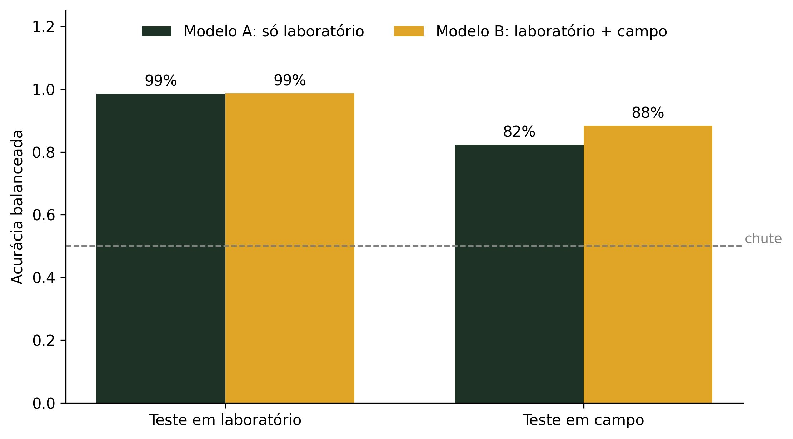
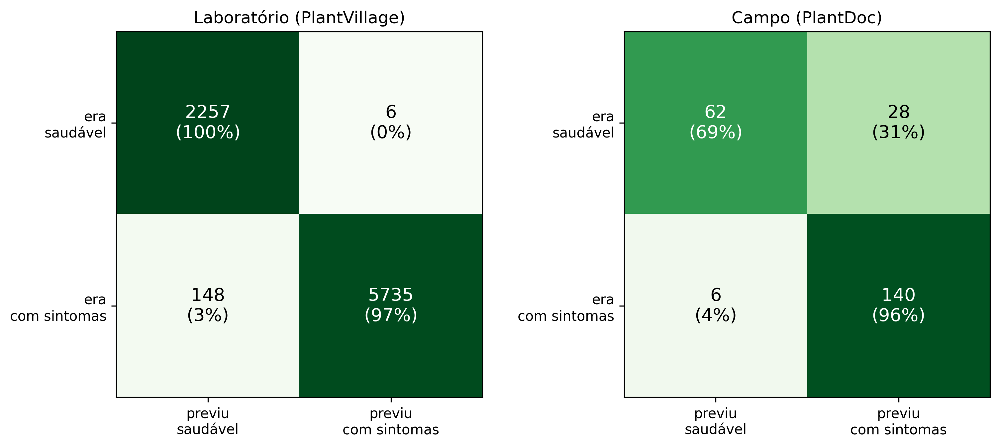
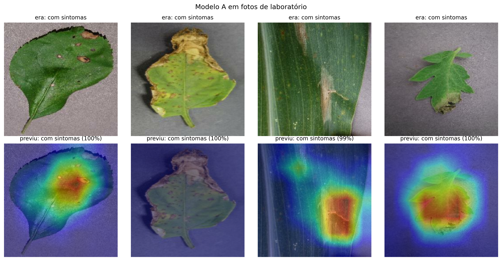
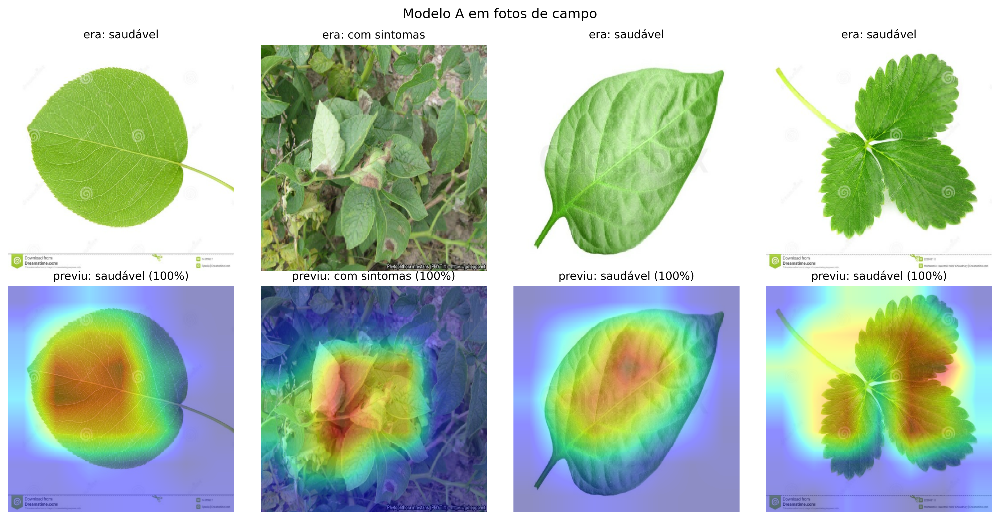

# IA no Cerrado

Material aberto da oficina **IA no Cerrado**, da Rede Iberoamericana de Prospectiva em Inteligência Artificial para Biociências e Biotecnologia (**RIABIA-pro**, CYTED).

[](https://colab.research.google.com/github/giovannafg/ia-no-cerrado/blob/main/notebooks/ia_no_cerrado_folhas.ipynb)

## A pergunta

> Um modelo treinado com fotos de **laboratório** continua acertando com imagens de **campo**?

## A oficina

A oficina é voltada ao ensino médio e dura 2 horas, em três momentos:

1. **Teoria com folhas reais.** Uma atividade sem computador: as alunas criam perguntas de sim ou não sobre as folhas e montam uma árvore de decisão.
2. **Demonstração deste notebook.** Mostra a diferença entre fotos de laboratório e de campo.
3. **Prática no [Teachable Machine](https://teachablemachine.withgoogle.com/).** As participantes treinam o próprio modelo, direto no navegador.

## O experimento

| | Treino | Teste |
|---|---|---|
| **Modelo A** | PlantVillage (laboratório) | PlantVillage (teste separado) e PlantDoc `test` |
| **Modelo B** | PlantVillage + PlantDoc `train` | PlantVillage (teste separado) e PlantDoc `test` |

- As 38 classes originais (espécie + doença) são agrupadas em duas: **saudável** e **com sintomas**.
- O modelo é a MobileNetV2 pré-treinada no ImageNet (aprendizado por transferência), com ajuste fino das últimas camadas.
- O Grad-CAM mostra quais regiões da imagem mais pesaram na decisão.
- Semente aleatória: 42.

## Resultados

| Acurácia balanceada | Teste laboratório (n = 8.146) | Teste campo (n = 236) |
|---|---|---|
| **Modelo A** | 98,6% | 82,4% |
| **Modelo B** | 98,7% | 88,4% |



**Achados:**

1. O Modelo A perde cerca de 16 pontos fora do laboratório.
2. O erro se concentra nas folhas saudáveis. No campo, o Modelo A classifica 31% delas (28 de 90) como "com sintomas". O Modelo B reduz esse erro para 9% (8 de 90).
3. O Modelo B tem um custo. No campo, as folhas com sintomas classificadas como saudáveis sobem de 4% (6 de 146) para 14% (21 de 146). O modelo fica mais equilibrado, e a acurácia balanceada sobe de 82,4% para 88,4%. Mas ele passa a deixar escapar mais folhas com sintomas.
4. Nos exemplos de Grad-CAM, o modelo olha principalmente para a folha e as lesões.



*Matrizes de confusão do Modelo A no teste de laboratório (esquerda) e de campo (direita).*



*Grad-CAM do Modelo A em fotos de laboratório: as cores quentes marcam as regiões que mais pesaram na decisão.*



*Grad-CAM do Modelo A em imagens de campo (PlantDoc).*

As demais figuras (amostras laboratório × campo, curvas de treino e matrizes do Modelo B) estão em [`figuras/`](figuras/). As métricas completas estão em [`resultados/`](resultados/).

## Limitações

- **O teste de campo é pequeno.** São só 236 imagens (90 saudáveis e 146 com sintomas). Na acurácia balanceada, cada folha saudável vale cerca de 0,56 ponto e cada folha com sintomas cerca de 0,34 ponto. A margem de incerteza é de cerca de ±4 pontos. A queda laboratório → campo é robusta. A melhora do Modelo B (cerca de 6 pontos) deve ser vista como preliminar.
- **O PlantDoc não é estritamente "campo".** O dataset foi montado com imagens coletadas da web. Parte delas são fotos de banco de imagens, com fundo branco e marca d'água.
- **Não são plantas do Cerrado.** Os modelos foram treinados com plantas cultivadas, não com espécies nativas do Cerrado.

## Como rodar

**No Google Colab (recomendado):**

1. Abra o notebook pelo botão no topo desta página.
2. Ative a GPU em *Ambiente de execução › Alterar o tipo de ambiente de execução › GPU*.
3. Rode as células em ordem. Os dados são baixados automaticamente.

**No computador:**

```bash
pip install -r requirements.txt
jupyter notebook notebooks/ia_no_cerrado_folhas.ipynb
```

**Configurações principais** (primeira seção do notebook):

- `MAX_POR_CLASSE_PV`: quantas fotos usar de cada classe original do PlantVillage. `None` usa todas. Para uma demonstração rápida, use `300`.
- `EPOCAS`: número máximo de épocas de treino. O treino para antes se parar de melhorar. Para uma demonstração rápida, use `5`.

Os resultados acima foram obtidos com `MAX_POR_CLASSE_PV = None` e `EPOCAS = 8`.

A seção 10 (teste com as suas fotos) é opcional e pode ser pulada.

## Estrutura do repositório

```
ia-no-cerrado/
├── README.md
├── LICENSE
├── requirements.txt
├── notebooks/
│   └── ia_no_cerrado_folhas.ipynb
├── figuras/
│   ├── 01_laboratorio_vs_campo.png
│   ├── 02_treino_modelo_A.png
│   ├── 03_matrizes_modelo_A.png
│   ├── 04_treino_modelo_B.png
│   ├── 05_matrizes_modelo_B.png
│   ├── 06_comparacao_modelos.png
│   ├── 07_gradcam_laboratorio.png
│   └── 08_gradcam_campo.png
└── resultados/
    ├── resultados.csv
    ├── resumo.json
    ├── historico_modelo_A.csv
    └── historico_modelo_B.csv
```

Os modelos treinados (`.keras`) e as pastas `dados/` e `minhas_fotos/` são gerados pelo notebook e não são versionados.

## Dados e licenças

| Dataset | Conteúdo | Licença | Referência |
|---|---|---|---|
| [PlantVillage](https://github.com/spMohanty/PlantVillage-Dataset) | ~54 mil fotos de folhas sobre fundo uniforme, 14 espécies | CC BY-SA 3.0 | Hughes, D. P.; Salathé, M. *An open access repository of images on plant health to enable the development of mobile disease diagnostics.* arXiv:1511.08060, 2015. |
| [PlantDoc](https://github.com/pratikkayal/PlantDoc-Dataset) | ~2,6 mil fotos de folhas em condições reais, 13 espécies | CC BY 4.0 | Singh, D.; Jain, N.; Jain, P.; Kayal, P.; Kumawat, S.; Batra, N. *PlantDoc: A Dataset for Visual Plant Disease Detection.* CoDS-COMAD 2020. |

As imagens **não** são redistribuídas neste repositório: o notebook baixa cada dataset da fonte original.

Os autores do PlantVillage pedem que modelos treinados com os dados também sejam compartilhados sob CC BY-SA 3.0. Por isso, os modelos gerados pelo notebook seguem essa licença.

## Próximos passos

- Validar com dados brasileiros (Digipathos, Embrapa).
- Repetir o experimento com várias sementes.

## Licença do código

O código deste repositório está sob a licença MIT (veja [`LICENSE`](LICENSE)).

## Créditos

Giovanna Felipe, Faculdade de Ciências e Tecnologias em Engenharia (FCTE), Universidade de Brasília.

RIABIA-pro / CYTED.
